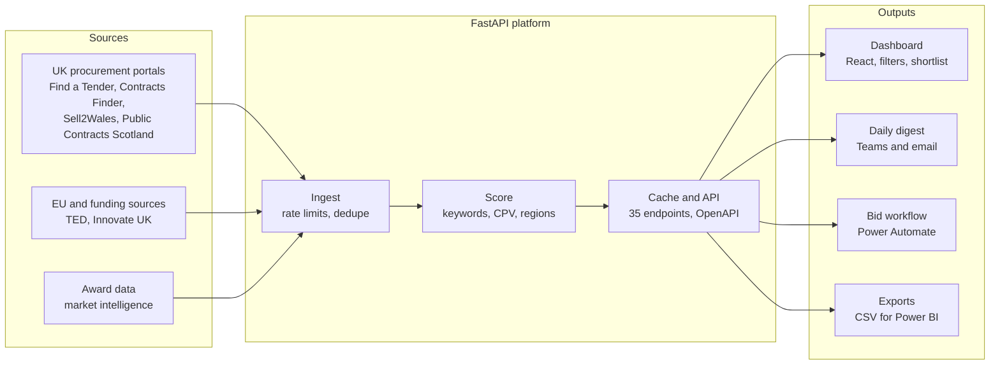

# Tender Intelligence Platform: From Requirements to Delivery

## Summary

I replaced my employer's manual tender search with a tender intelligence platform that now feeds the live bid pipeline. The business development team had been checking procurement portals by hand and missing relevant opportunities. I gathered their needs, built the product in increments, tested it against real data, and handed it over into company systems with full documentation in September 2026.

> The backlog and user stories below were written up afterwards to show how the work maps to agile practice. During delivery, requirements were gathered informally through conversations with the team and directors.

| Item | Detail |
| --- | --- |
| Product | Tender Intelligence Platform (internal), version 2.0.0 |
| Users | Business development team, directors, Commercial Director (sponsor) |
| My role | Product owner, analyst and developer (sole) |
| Data sources | 9: Find a Tender, Contracts Finder, Sell2Wales, Public Contracts Scotland, TED, Innovate UK projects and competitions, award data |
| Scale | 1,000+ cached notices, 35 documented API endpoints |
| Delivery to users | React dashboard, daily digest to Microsoft Teams and email, CSV exports |
| Stack | Python, FastAPI, Pydantic, React (Vite), Power Automate, SharePoint, Microsoft Graph |

## 1. Discovery and problem framing

The core problem was that relevant tenders were found late or not at all. Opportunities were spread across several portals, each with different search tools, and checking them depended on individual effort.

**Current process (as-is)**

1. A team member searched each portal separately by keyword.
2. Promising notices were read in full to judge relevance.
3. Deadlines and decisions were tracked informally.
4. Outcomes, including who won tenders the company lost, were rarely recorded.

**Pain points**

- Missed opportunities, especially notices close to their deadline.
- Repeated manual effort across four UK portals plus EU and grant sources.
- No shared view of the pipeline, and no record of why bids were or were not pursued.
- No market intelligence on which competitors were winning similar work.

**Stakeholders**

| Stakeholder | Interest |
| --- | --- |
| Commercial Director (sponsor) | Pipeline visibility, win rate, nothing missed |
| Business development team | Fewer manual searches, relevant opportunities first |
| Directors and technical leads | Quick go/no-go information on each tender |
| IT | Security, credentials, supportability |

**Problem statement:** the team needs one reliable place to see relevant public sector opportunities early, decide quickly whether to bid, and learn from outcomes.

## 2. Requirements gathering

Requirements came from three sources: conversations with the bid team and directors, observing the manual process, and the constraints of each data source's API.

**Functional requirements**

| ID | Requirement | Priority |
| --- | --- | --- |
| F1 | Collect notices automatically from all UK procurement portals | Must |
| F2 | Score each notice for relevance to the company's four service areas | Must |
| F3 | Filter and search by keyword, region, CPV code, source, score and deadline | Must |
| F4 | Send a daily digest of the most relevant open opportunities to Teams and email | Must |
| F5 | Shortlist tenders and record bid decision, confidence and outcome | Should |
| F6 | Flag notices from a watchlist of 30 target authorities | Should |
| F7 | Show who won tenders the company bid on, and competitor awards | Should |
| F8 | Summarise a tender with AI to support go/no-go | Could |
| F9 | Cover EU (TED) and Innovate UK funding opportunities | Could |
| F10 | Export results as CSV for reporting | Could |

**Non-functional requirements**

| ID | Requirement |
| --- | --- |
| N1 | Respect each portal's rate limits and avoid exhausting API quotas |
| N2 | Keep credentials out of code and version control |
| N3 | Be documented well enough for someone else to run and support |
| N4 | Run from company infrastructure, not one person's machine |
| N5 | Exclude closed and awarded notices from the digest to keep it relevant |

## 3. Backlog: epics and user stories

The requirements group into five epics. Each story is on this repository's [Issues](../../issues) with its acceptance criteria.

| Epic | Covers |
| --- | --- |
| E1 Data ingestion | F1, F9, N1 |
| E2 Relevance and search | F2, F3, F6 |
| E3 Alerts and digest | F4, N5 |
| E4 Bid pipeline and intelligence | F5, F7, F8, F10 |
| E5 Operations and handover | N2, N3, N4 |

## 4. Solution design

The design keeps every source flowing through one scoring step, so all opportunities are judged the same way whatever portal they came from.

**Key design decisions**

- **One data model.** Every notice, whatever its source, is stored with the same fields, including notice type, Open Contracting ID, region and CPV codes.
- **Transparent scoring.** Each score lists the keywords and service areas it matched, so users can see why a notice ranked highly. Watchlist authorities are flagged and urgent notice types receive a boost.
- **API first.** The dashboard, digest and exports all read from the same documented API, so new outputs can be added without changing the core.
- **Microsoft 365 integration.** The digest posts to Teams through a webhook, and bid workflows run in Power Automate and SharePoint under an Entra ID app registration.

## 5. Iterative delivery

The product was delivered in small, usable increments, each released to the team before the next began.

| Increment (newest first) | What it delivered | Epics |
| --- | --- | --- |
| Handover (Sept 2026) | Moved into company GitHub and systems, README, access handover | E5 |
| Documentation (July 2026) | Summaries and descriptions for all endpoints, standalone API reference, onboarding guide | E5 |
| v2.0.0 (by July 2026) | TED, Innovate UK, market awards, shortlist with outcomes, AI summaries | E1, E4 |
| Bid workflow | Five Power Automate flows: folder set-up, deadline reminders, verification, evidence records, Teams alerts | E3, E4 |
| Digest | Daily Teams and email digest of actionable notices | E3 |
| Dashboard | React dashboard with filters, watchlist flags and notice-type badges | E2 |
| MVP | Find a Tender, Contracts Finder and Sell2Wales feeds with keyword scoring | E1, E2 |

Each increment followed the same loop: agree what the team needed, build the smallest useful version, test it on live data, release it, then refine from what users and the data showed.

## 6. Testing and quality

Testing checked the product against live data, not just whether the code ran. Most defects produced plausible but wrong results rather than errors, so each fix was verified against the source.

| Defect | Impact | Fix |
| --- | --- | --- |
| Short acronyms matching inside other words | Irrelevant notices scored as Strong match | Whole-word, case-sensitive matching for acronyms |
| Scores capped at the maximum | Top results could not be ranked | Weighted scoring proposed so scores differentiate |
| Garbled characters (for example in £ and apostrophes) | Unreadable values and titles | Correct text decoding at source, plus repair of cached records |
| Sell2Wales details left unparsed | Missing deadlines, values and regions | Targeted extraction from the notice text |
| Unstated values recorded as zero | Totals and value sorting distorted | Zero normalised to empty |
| Aggressive polling of Find a Tender | API quota exhausted | Backoff, delays between pages and a 30-minute refresh guard |
| 30-day fetch window | Notices near deadline missed | Window extended to 45 days |

## 7. Release, handover and adoption

The product was handed over into company systems in September 2026, so it no longer depends on one person or one laptop.

- [x] Pushed the code that actually runs to the company GitHub organisation
- [x] Kept credentials out of the repository and provided a configuration template
- [x] Checked the full version history for any credentials ever committed
- [x] Wrote a README covering sources, scheduling, digest delivery, SharePoint lists, scoring logic and stored state
- [x] Re-pointed portal accounts to a shared team mailbox
- [x] Reported where the app secret is stored and when it expires, for IT to rotate
- [x] Listed the linked Power Automate flows

Adoption was supported by a standalone API reference, a plain-English onboarding guide, and briefing slides for directors.

## 8. Outcomes and lessons learned

The platform turned four separate manual searches into one automated feed that reaches the team every morning and now feeds the live bid pipeline. The shortlist also records a score-accuracy rating for each tender, giving a labelled dataset for tuning the scoring over time.

1. **Plan for handover from day one.** Documenting at the end took far more effort than writing it as I went.
2. **Plausible output is the riskiest kind of defect.** Checking results against the source caught problems no error message would.
3. **Less is more in alerts.** Excluding closed and awarded notices made the digest more useful.
4. **Respect external limits.** Gentler polling worked better than trying to fetch faster.
5. **Formal user stories would have helped.** Writing them up afterwards showed where clearer acceptance criteria would have saved rework.

## 9. How this maps to an agile product role

| Product practice | What I did | In a Scrum team I would |
| --- | --- | --- |
| Capturing requirements | Conversations with the bid team and directors; observed the manual process | Run structured workshops and interviews, and record outcomes |
| User stories and acceptance criteria | Informal specifications and verification checks | Write stories with acceptance criteria agreed before development |
| Backlog refinement | Prioritised fixes from live data and user needs | Refine and estimate the backlog with the team each sprint |
| Sprint planning and delivery | Small, usable increments released to users | Commit to a sprint goal and deliver a done increment each sprint |
| Reviews and feedback | Score-accuracy feedback; refined after each release | Demo at sprint reviews and capture stakeholder feedback |
| Documentation | API reference, README, onboarding guide | Keep documentation current within the definition of done |
